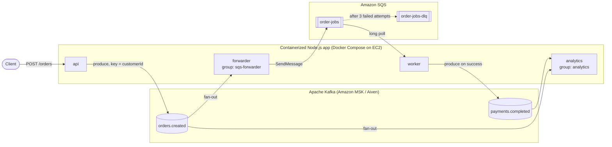

# AWS Kafka + SQS with Terraform: event-driven order pipeline

[](https://github.com/dollarsmoney/aws-kafka-sqs-terraform/actions/workflows/ci.yml)


A hands-on, production-style project that runs an **event-driven order pipeline** on **Apache Kafka**
(Amazon MSK or Aiven) and **Amazon SQS**. All infrastructure is defined with **Terraform modules**, and the
app is a **containerized Node.js** service deployed to **EC2**.

It shows *when to use which*: Kafka as the event stream that many teams react to, and SQS as the work queue
where exactly one worker does each job, with retries and a dead-letter queue.

---

## Architecture



**Flow of one order:**
1. The `api` publishes `order.created` to Kafka and returns `202` immediately.
2. Two independent consumer groups each get their own copy of the event (fan-out):
   - `analytics` updates totals.
   - `forwarder` turns it into a job on the SQS queue.
3. The `worker` takes the job (competing consumers), "charges the card", publishes `payment.completed` to Kafka, and deletes the job.
4. If processing fails, SQS retries after the visibility timeout. After 3 attempts, the job moves to the **DLQ**.

| | Kafka (MSK / Aiven) | SQS |
|---|---|---|
| Model | Append-only **log**. Events stay after they're read. | **Queue**. A message is deleted once it's processed. |
| Multiple readers | Every **consumer group** gets every event (fan-out) | Consumers **compete**: each message goes to one worker |
| Ordering | Per partition (keyed by `customerId`) | Best effort (FIFO queues available) |
| Replay | Yes: new group or offset reset | No |
| Failure handling | Built by the app (skip, retry, DLQ topic) | Built in: visibility timeout, redrive, **DLQ** |

---

## What this project demonstrates

**Infrastructure as Code (Terraform)**
- Reusable modules: `network`, `sqs`, `msk`, `ecr`, `ec2_app`, wired together in a root module
- **Kafka topics as code** on Aiven (`aiven_kafka_topic`), including **importing** an existing topic into state
- Input validation, preconditions, lifecycle policies, `templatefile()` user data, a `default_tags` tagging strategy

**AWS**
- **Amazon MSK:** a 2-broker cluster in private subnets, a custom broker configuration, TLS in transit, CloudWatch broker logs
- **Amazon SQS:** a queue with a dead-letter queue, a redrive policy plus a redrive-allow policy, long polling, SSE
- **EC2 on Graviton (ARM)**, bootstrapped by user data into Docker Compose, with images pulled from **ECR**
- **Security:**
  - least-privilege IAM: SQS actions are scoped to the two queues only
  - **IMDSv2 only**: hop limit 2 so containers can get role credentials, so no access keys anywhere
  - **SSM Session Manager** instead of SSH (no port 22)
  - security groups that only let the app reach the brokers

**Messaging patterns**
- Event streaming vs work queues, and **fan-out** vs **competing consumers**
- **At-least-once delivery**:
  - Kafka offsets are committed only after the SQS send succeeds.
  - The worker publishes its event *before* deleting the SQS message.
- Poison-message handling: bad or unknown messages are skipped so they can't block a partition
- Partition keys for per-customer ordering
- **Mutual TLS** (client certificates) to a managed Kafka service (Aiven)

**Operations**
- **Structured JSON logging** (pino):
  - `service`, `event`, `topic`, `partition`, `offset` and `orderId` on every line, so one order can be traced across services
  - log level set by config (`LOG_LEVEL`)
- **Graceful shutdown** on SIGTERM: consumers leave their group cleanly, and long polls are aborted
- **12-factor config**: everything comes from env vars, and secrets (certs, tokens) are never baked into images or committed
- A free local environment (Kafka in KRaft mode plus ElasticMQ for SQS) that mirrors the cloud setup
- **CI** with GitHub Actions: `terraform fmt`/`validate` on both Terraform roots, an app syntax check and a Docker build

---

## Tech stack

| Area | Tools |
|---|---|
| IaC | Terraform (AWS provider v6, Aiven provider v4) |
| Cloud | Amazon MSK, SQS, EC2 (Graviton), ECR, IAM, VPC, SSM, CloudWatch |
| Streaming | Apache Kafka 3.9 (Amazon MSK, Aiven, `apache/kafka` locally) |
| App | Node.js 24, Express, kafkajs, AWS SDK v3, pino |
| Containers | Docker (multi-stage, non-root), Docker Compose |
| CI | GitHub Actions |

---

## Repository layout

```
infra/                     Terraform for AWS
  main.tf                  wires the modules together
  modules/network          VPC, public subnets (EC2), private subnets (MSK), no NAT gateway
  modules/sqs              work queue + DLQ + redrive policy
  modules/msk              MSK cluster, broker config, security group, CloudWatch logs
  modules/ecr              image repository + lifecycle policy
  modules/ec2_app          instance, IAM role, security group, user_data → docker compose
infra/aiven/               Terraform for Kafka topics on Aiven (topics.tf = the topic catalog)
app/                       Node.js app, one image with four roles
  src/api.js               HTTP API → produces order.created
  src/forwarder.js         Kafka consumer → SQS
  src/analytics.js         Kafka consumer of both topics (fan-out demo)
  src/worker.js            SQS worker → produces payment.completed, DLQ demo
  src/kafka.js, logger.js  shared Kafka client (plaintext / TLS / mTLS) and structured logger
  docker-compose.local.yml everything local: Kafka + ElasticMQ + app
  docker-compose.aiven.yml app against Aiven Kafka
scripts/                   push-image.sh, deploy.sh (SSM), logs.sh (SSM)
.github/workflows/ci.yml   CI pipeline
```

---

## Quick start

### Option 1: fully local (free, ~2 minutes)
Requires Docker.
```bash
cd app
docker compose -f docker-compose.local.yml up --build -d

curl -s -X POST localhost:3000/orders -H 'content-type: application/json' \
  -d '{"customerId":"c1","amount":42}'

# an order that always fails → retried 3× → lands in the DLQ
curl -s -X POST localhost:3000/orders -H 'content-type: application/json' \
  -d '{"customerId":"c2","amount":10,"simulateFailure":true}'

docker compose -f docker-compose.local.yml logs -f --no-log-prefix | npx pino-pretty
```
Queue depths are shown at http://localhost:9325 (ElasticMQ UI).

### Option 2: managed Kafka on Aiven (free tier) + local SQS
1. In the Aiven console, use **Client certificate** auth and download `ca.pem`, `service.cert` and `service.key` into `app/certs/` (git-ignored).
2. Create the topics with Terraform. Topics are infrastructure, so the app never creates them here:
   ```bash
   cd infra/aiven
   cp terraform.tfvars.example terraform.tfvars        # your project + service name
   export AIVEN_TOKEN=...                              # Aiven console → Tokens (keep it out of git)
   terraform init && terraform plan && terraform apply
   ```
3. Configure and run the app:
   ```bash
   cd app
   cp .env.example .env                                # set KAFKA_BROKERS
   docker compose -f docker-compose.aiven.yml up --build
   ```
   A new topic later means adding one line to `infra/aiven/topics.tf`, then `terraform apply`.

### Option 3: full AWS deployment (MSK + SQS + EC2)
> ⚠️ **Cost:** MSK bills per broker-hour, even when idle. This setup costs roughly **$2–3/day**.
> Run `terraform destroy` when you're done. MSK takes about 25 min to create and about 15 min to destroy.
> AWS Free-plan accounts must upgrade to a paid plan before MSK can be used.

Prerequisites: AWS CLI configured, Terraform ≥ 1.6, Docker with buildx.
```bash
cd infra
cp terraform.tfvars.example terraform.tfvars
# set my_ip (only this IP can reach the API):  echo "$(curl -s https://checkip.amazonaws.com)/32"

terraform init
terraform apply -target=module.ecr     # 1. image repository first
../scripts/push-image.sh               # 2. build (linux/arm64) + push to ECR
terraform apply                        # 3. VPC, SQS, MSK, EC2 (~25 min)

API=$(terraform output -raw api_url)
curl -s -X POST $API/orders -H 'content-type: application/json' -d '{"customerId":"c1","amount":42}'
../scripts/logs.sh worker 50           # container logs over SSM, no SSH

../scripts/push-image.sh && ../scripts/deploy.sh   # redeploy after code changes
terraform destroy                                  # tear everything down
```

---

## Configuration

All settings are environment variables. See [`app/.env.example`](app/.env.example).

| Variable | Purpose |
|---|---|
| `KAFKA_BROKERS` | Bootstrap brokers (`host:port,...`) |
| `KAFKA_SSL`, `KAFKA_SSL_CA_FILE`, `KAFKA_SSL_CERT_FILE`, `KAFKA_SSL_KEY_FILE` | Plaintext, TLS (MSK) or mutual TLS (Aiven) |
| `ORDERS_TOPIC`, `PAYMENTS_TOPIC` | Topic names this app uses |
| `KAFKA_CREATE_TOPICS` | `true` only for local dev. In production, topics come from Terraform and the app fails fast if they're missing. |
| `SQS_QUEUE_URL`, `SQS_ENDPOINT` | Work queue (endpoint only for local ElasticMQ) |
| `LOG_LEVEL`, `APP_ENV` | Logging verbosity and environment tag |

---

## Design decisions and trade-offs

- **No NAT gateway.** EC2 sits in a public subnet behind a security group that only allows one IP. MSK sits in private subnets with no internet route. This saves about $32/month for a learning environment.
- **Unauthenticated TLS on MSK.** Network isolation through security groups keeps it simple. Production would add **IAM auth** (port 9098), which is listed as the next step.
- **mTLS on Aiven.** A client certificate per service, with certificates mounted at runtime and never baked into the image.
- **Topics as code.** The app only *verifies* its topics exist (`KAFKA_CREATE_TOPICS=false`), mirroring production, where application identities can't create topics.
- **At-least-once over exactly-once.** Simpler and the norm in practice. Consumers should therefore be idempotent (e.g. dedupe on `orderId`).
- **kafkajs** for readability. For production Node.js, `@confluentinc/kafka-javascript` (librdkafka) is the maintained choice.

## Roadmap
- [ ] MSK IAM authentication, plus a separate least-privilege Aiven user and ACLs per service
- [ ] Remote Terraform state (S3 backend with locking)
- [ ] CloudWatch alarm on DLQ depth and consumer-lag monitoring
- [ ] Idempotent worker (dedupe store) and a schema registry for event contracts
- [ ] Kubernetes (EKS) deployment with Pod Identity, ConfigMaps and Secrets

## License
[MIT](LICENSE)
